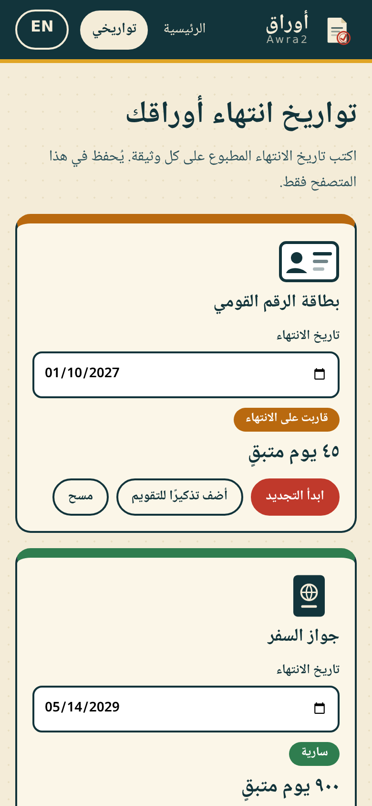
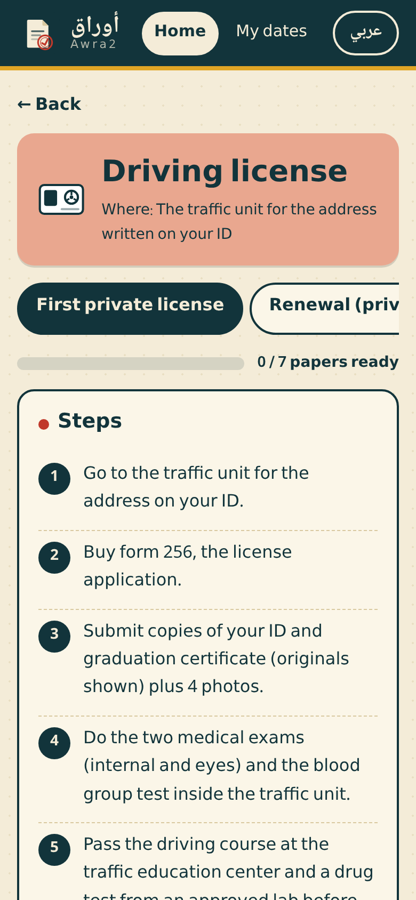

<p align="center"></p>

# أوراق | Awra2

**Your Egyptian government papers, ready before you reach the counter.**
ID card, passport and driving license: steps, papers to bring, fees, and a checklist you can print.

**Live demo:** https://yousefkhames.github.io/awra2/

| Home | Guide (Arabic, RTL) | My dates | Guide (English) |
|---|---|---|---|
|  |  |  |  |

## What it does

- Three documents, three cases each (first time, renewal, lost or damaged).
- Step by step route you can tick off, and a papers list that changes with your case (male, married, under 16, qualification not on the ID).
- Fee picker with the speed you choose (normal, urgent, immediate) and a live total. The first private license fee is itemized and summed.
- Printable checklist (clean print layout with empty boxes) and "copy as text" for WhatsApp.
- "My dates": save the expiry date of each document, see days left, get a flag 90 days ahead, and download a calendar reminder (.ics, 60 days before expiry).
- Arabic and English, full RTL and LTR, mobile first, keyboard friendly.
- Everything saves in your browser (localStorage). No server, no account, no tracking.

## Sources and dates

Every paper, step list and fee cites its sources inside the app, with the date they were checked (26 Nov 2026) and whether the source is government or press. Sources are listed in `data.js`. Where we could not confirm a figure from a reliable source (ID replacement fee, license renewal and replacement fees), the app shows no number and says so, rather than guess.

Known disagreement: one press report from 21 Nov 2026 gave a passport fee range of 900 to 2950 EGP, while most sources repeat 1110 / 1300 / 1600 on a 705 EGP base fee. The app shows the common figures and warns about the difference.

## Tech

Plain HTML, CSS and JavaScript. No build step, no dependencies in the app. Content lives in `data.js` (works in the browser and in Node).

```
npm test                         # 11 unit tests on the data and the fee, date and filter logic
node tests/e2e.js <url>          # 22 real-browser checks (needs puppeteer-core and Chrome)
```

## Honest limits

- This is **not** a government site and not legal advice. Fees and rules change, and offices differ. Confirm before you pay.
- Steps are a plain summary of what the published sources describe. Office practice can vary.
- GitHub Pages is a demo host. Your data lives in your own browser only: clearing site data deletes it, and it does not sync between devices.
- Reminders are a downloaded calendar file, not push notifications.
- Only private licenses are covered, not professional ones, and Egypt only.

## License

MIT. See [LICENSE](LICENSE).
