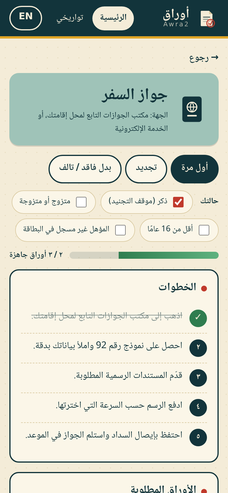
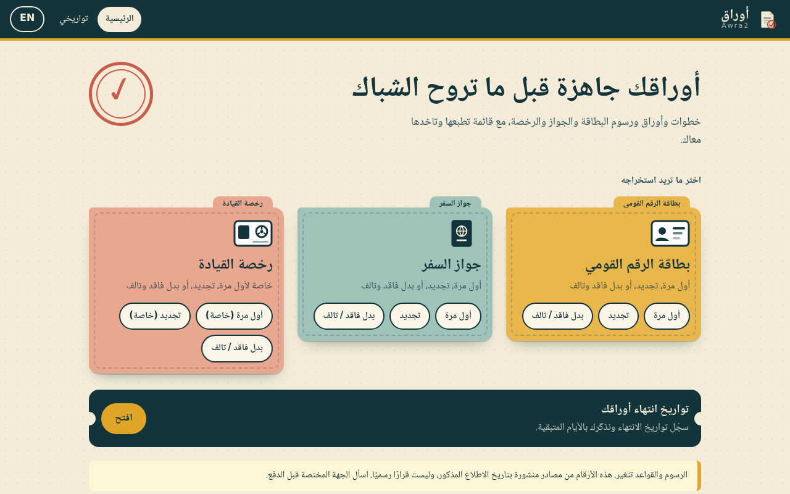
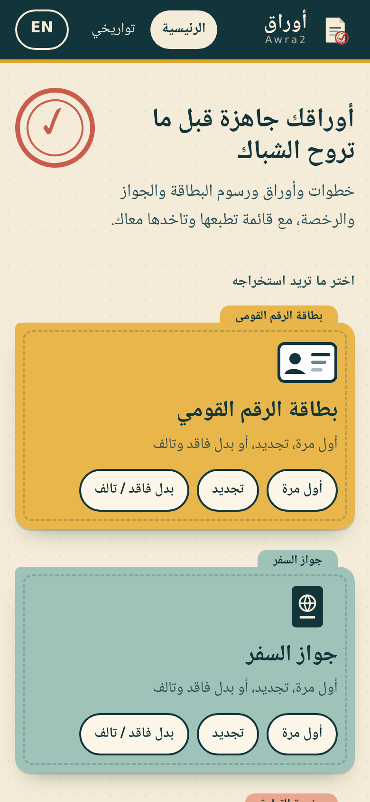

<p align="center"></p>

# أوراق | Awra2

**Your Egyptian government papers, ready before you reach the counter.**
ID card, passport and driving license: steps, papers to bring, fees, and a checklist you can print.

**Live demo:** https://yousefkhames.github.io/awra2/

| Home | Guide (Arabic, RTL) | My dates | Guide (English) |
|---|---|---|---|
|  |  |  |  |

## Screenshots

Captured from the live site (https://yousefkhames.github.io/awra2/).

<p>
  
  
</p>

## What it does

- Three documents, three cases each (first time, renewal, lost or damaged).
- Step by step route you can tick off, and a papers list that changes with your case (male, married, under 16, qualification not on the ID).
- Fee picker with the speed you choose (normal, urgent, immediate) and a live total. The first private license fee is itemized and summed.
- Printable checklist (clean print layout with empty boxes) and "copy as text" for WhatsApp.
- "My dates": save the expiry date of each document, see days left, get a flag 90 days ahead, and download a calendar reminder (.ics, 60 days before expiry).
- Arabic and English, full RTL and LTR, mobile first, keyboard friendly.
- Works offline after the first visit and can be added to the home screen, so the checklist is there at the counter even without signal.
- Everything saves in your browser (localStorage). No server, no account, no tracking.

## Sources and dates

Every paper, step list and fee cites its sources inside the app, with the date they were checked (26 Nov 2026) and whether the source is government or press. Sources are listed in `data.js`. Second pass (26 Nov 2026): the national ID replacement fee now shows the three form prices (50 / 125 / 175 EGP) from two press reports (Dostor 14 Aug 2026, Masrawy 28 Aug 2026), with the 50 EGP late-replacement fine (Al-Masry Al-Youm, 3 Sep 2026). That is press, not an official price list. For driving-license renewal the Interior Ministry's own statement (30 Sep 2026) says the fee is the one posted on the board in each traffic unit, with no other payments and no safety-equipment requirement. Press figures for the new renewal price disagree (310 EGP in Dar Al-Hilal, 4 Oct 2026; a cut of up to 500 EGP in Youm7, 30 Sep 2026; about 1105 EGP before the cut in Al-Ahram, 16 Jul 2026), so the app lists them as reported figures with their dates and shows no single total. Where we still could not confirm a figure (driving-license replacement fee, damaged-license rules, ID late-renewal fine), the app shows no number and says so, rather than guess.

Known disagreement: one press report from 21 Nov 2026 gave a passport fee range of 900 to 2950 EGP, while most sources repeat 1110 / 1300 / 1600 on a 705 EGP base fee. The app shows the common figures and warns about the difference.

## Tech

Plain HTML, CSS and JavaScript. No build step, no dependencies in the app. Content lives in `data.js` (works in the browser and in Node).

```
npm test                         # 11 unit tests on the data and the fee, date and filter logic
node tests/e2e.js <url>          # 23 real-browser checks (needs puppeteer-core and Chrome)
```

## Honest limits

- No official fee table for license renewal or replacement was found on moi.gov.eg or the Digital Egypt portal pages we could read, only the statement above. Check the board at the traffic unit.
- Lost driving license papers come from two press reports (Al-Ahram Gate, 13 Mar 2026, and Youm7, 20 Oct 2026). They differ a little (prosecution approval of the loss report, clearance certificate), and the app says so. The fee is still not shown.
- This is **not** a government site and not legal advice. Fees and rules change, and offices differ. Confirm before you pay.
- Steps are a plain summary of what the published sources describe. Office practice can vary.
- GitHub Pages is a demo host. Your data lives in your own browser only: clearing site data deletes it, and it does not sync between devices.
- Reminders are a downloaded calendar file, not push notifications.
- Only private licenses are covered, not professional ones, and Egypt only.

## License

MIT. See [LICENSE](LICENSE).


## Demo / portfolio project

Static GitHub Pages site. Data stays in your browser. Sample data is fictional and results are not professional, legal, medical or financial advice.

By Yousef Khames · من تطوير يوسف خميس
